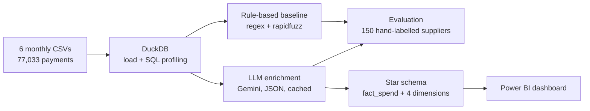
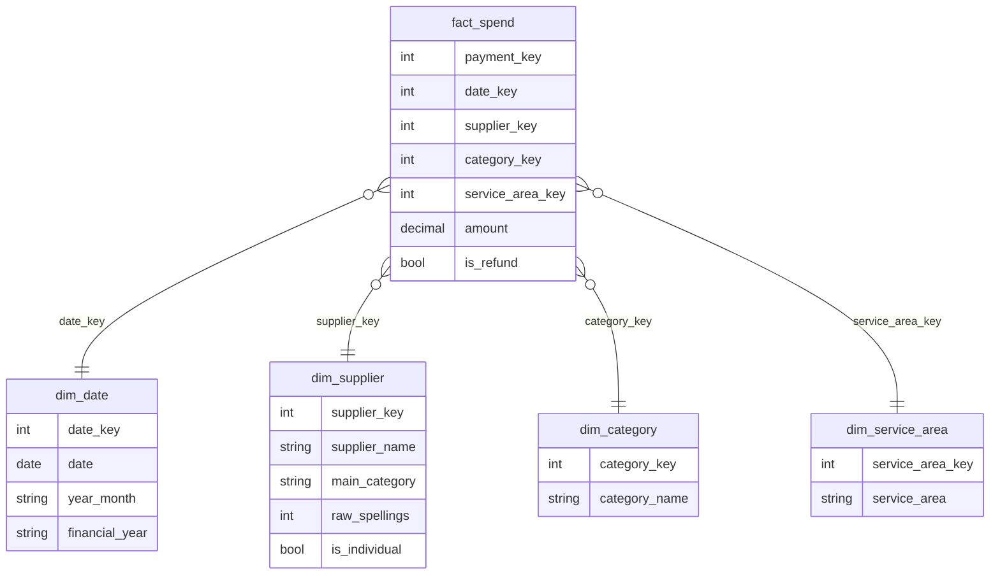
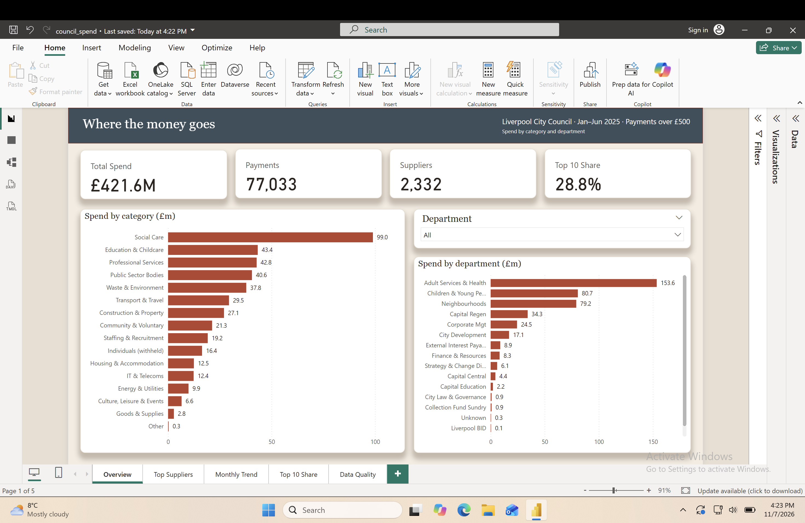
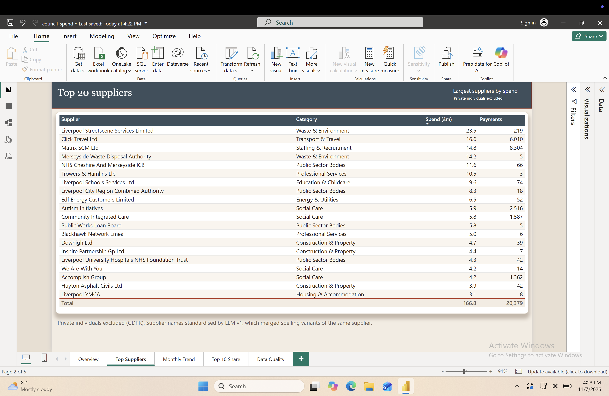
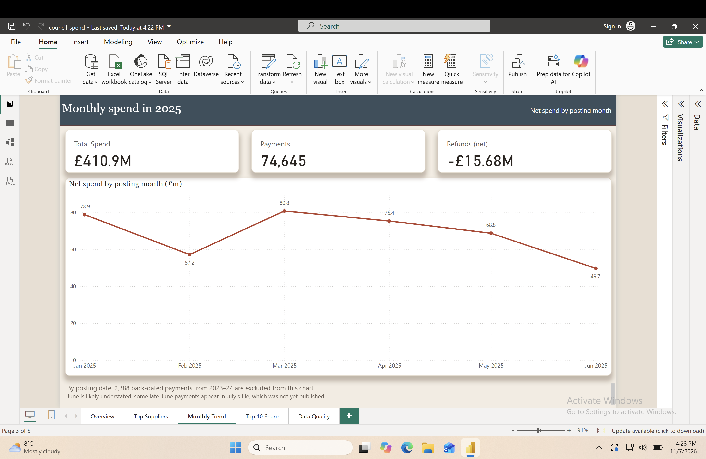
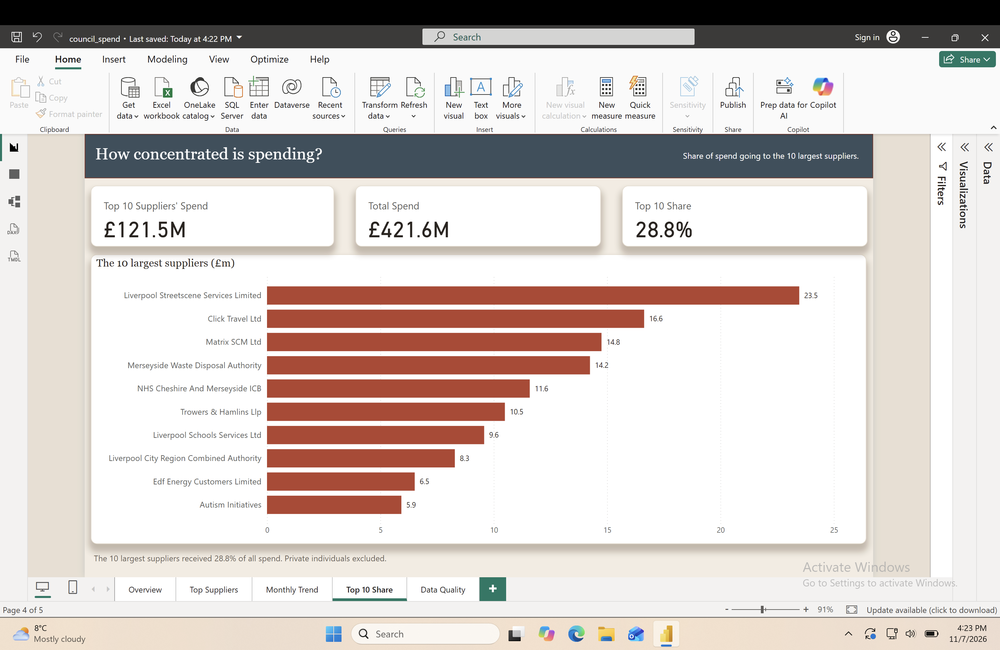
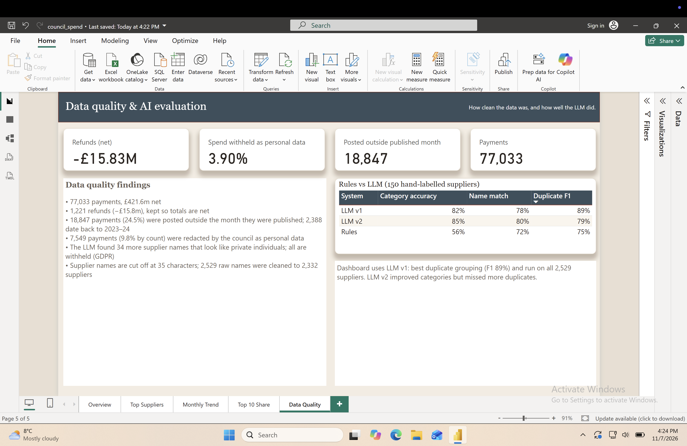

# UK Public Spending: Clean-up & Insights

I took six months of real, messy council spending data (Liverpool City Council, January–June 2025), checked its quality in SQL, used an LLM to standardise supplier names and categorise spend, measured the LLM against a hand-labelled sample and a rule-based baseline, modelled the result into a star schema and built a Power BI dashboard.

**Why this data:** English councils must publish every payment over £500 under the Local Government Transparency Code. The data is public and messy: the same supplier appears under several spellings, and names are cut off at 35 characters. That is the same problem banks and businesses have with merchant and supplier data.

## Pipeline

| Step | File | Tools |
|---|---|---|
| Load and profile | `notebooks/01_load_and_profile.ipynb` | DuckDB, SQL |
| Rule-based baseline | `notebooks/02_rule_based_baseline.ipynb` | Python, regex, rapidfuzz |
| LLM enrichment (prompt v1) | `notebooks/03_llm_enrichment.py` | Gemini API, structured JSON output |
| Labelling sample | `notebooks/04_make_labelling_sheet.ipynb` | pandas |
| Evaluation | `notebooks/05_evaluate.ipynb` | pandas |
| LLM prompt v2 | `notebooks/06_llm_v2.py` | Gemini API |
| Star schema | `notebooks/07_star_schema.ipynb` | DuckDB, SQL |
| Dashboard | `dashboard/` | Power BI |

## Data quality findings

Full report: [`data_quality_report.md`](data_quality_report.md)

- **77,033 payments**, £421.6m net. Amounts were stored as text (`"£15,499.00"`) and converted.
- **1,221 refunds** (negative amounts, -£15.8m), kept so totals are net.
- **24.5% of rows** have a posting date outside the month of the file they were published in, some back to November 2023. Files group payments by when they were reported, so all analysis uses posting date.
- **7,549 payments (9.8%, £15.1m)** were redacted by the council as personal data.
- Supplier names are **truncated at 35 characters** (288 names hit the limit, e.g. `LIVERPOOL STREETSCENE SERVICES LIMI`).
- **2,532 distinct supplier names (2,529 once the council's redacted placeholders are removed)**, with many spelling variants (`MERSEYTRAVEL` / `MerseyTravel` / `Merseytravel`).

## Supplier cleaning: rules vs LLM

- **Rules:** upper-case, strip punctuation and legal words (Ltd, PLC…), drop half-words left by truncation, then fuzzy-match names ≥92% similar with rapidfuzz. Categories from keyword rules on the name, then the expense type.
- **LLM:** Gemini 3.1 Flash-Lite, temperature 0, batches of 10 suppliers, a fixed list of 15 categories, structured JSON output, and a cache so no supplier is ever sent twice. Also flags suppliers that look like private individuals.

### Evaluation

I hand-labelled **150 suppliers** (a random sample plus 20 spelling-variant groups) with the correct name, category and whether it is a person, without looking at either system's answers first.

| | Rules | LLM v1 | LLM v2 |
|---|---|---|---|
| Category accuracy | 56% | 82% | **85%** |
| Name match | 72% | 78% | **80%** |
| Duplicate precision | **100%** | 80% | **100%** |
| Duplicate recall | 60% | **100%** | 65% |
| Duplicate F1 | 75% | **89%** | 79% |

*Name match ignores case, punctuation and legal suffixes. Duplicate precision/recall are measured on pairs of suppliers: of the pairs a system merged, how many really are the same organisation, and of the real duplicate pairs, how many it found.*

**What the errors showed (v1):**
- Care charities labelled Community & Voluntary instead of Social Care (6 cases).
- Consultants and surveyors labelled Construction because the council's expense type said "Build Work" (4). The expense type is a budget code and is often misleading; the rules suffered from this even more (e.g. a phone system supplier recorded as "education equipment").
- Things that are not organisations given real categories: a bank payment reference ("EVENTS BACS"), a private individual, and one invented name ("Stone" became "Stone Group").
- Branches of the same chain merged into one (e.g. separate nursery sites), which is why duplicate precision was 80%.

**Prompt v2** added category definitions, told the model to treat the expense type as a weak hint, keep branch and location names, never invent names, and remove legal suffixes. Categories improved to 85% and false merges disappeared, but the model became too cautious and missed real duplicates (recall 100% → 65%). Fixing one error type created another, which is why a labelled test set matters.

**Decision:** the dashboard uses **v1**. It has the best overall grouping (F1 89%) and was run on all 2,529 suppliers. For a "top suppliers" view, missing duplicates (splitting one supplier's spend) is worse than occasionally merging branches of the same chain.

## Star schema

- `fact_spend`: one row per payment (77,033).
- `dim_supplier`: 2,332 cleaned suppliers (from 2,529 raw names).
- `dim_date`: includes the UK council financial year (April–March).
- **Reconciliation:** the fact table matches the source exactly (77,033 rows, £421,596,634.99) with no orphaned keys.

## Dashboard

Built in Power BI on the star schema (`dashboard/council_spend.pbix`), with a custom "Albert Dock" theme (`dashboard/albert_dock_theme.json`).

**Overview**: £421.6m across 77,033 payments and 2,332 suppliers. Social Care is the largest category (£99.0m); Adult Services & Health the largest department (£153.6m).

**Top 20 suppliers**: the 20 largest suppliers received £166.8m. Private individuals excluded.

**Monthly trend**: net spend by posting month in 2025 (£410.9m). June is likely understated because late-June payments appear in July's file, which was not yet published.

**Supplier concentration**: the 10 largest suppliers received 28.8% of all spend (£121.5m).

**Data quality & AI evaluation**: refunds, withheld personal data, back-dated payments, and the rules vs LLM results.

## GDPR and personal data

Some council payments go to private individuals. The council redacts most of them, but the LLM flagged **34 more supplier names that look like private individuals**. All of these are grouped into a single supplier, "Private individual (withheld)", in the star schema, so no personal names appear in the dashboard. Raw files are not committed to this repository.

## Limitations

- Only January–June 2025 was published at the time, so this covers six months, not a full year.
- The evaluation sample is 150 suppliers labelled by one person; some categories are genuinely ambiguous (e.g. a charity providing care vs a general community group), so part of the remaining error is label ambiguity.
- Prompt v2 was written after reviewing errors on the same 150 suppliers it was scored on, so its improvement is likely an upper bound. A fresh held-out sample would give a fairer estimate.
- Branches of the same organisation were labelled as separate suppliers; a different rule would change the duplicate scores.
- LLM output can change between model versions; results are cached so this project is reproducible from the cache.

## How to run

1. Put the six council CSVs in `data/raw/`.
2. `pip install duckdb pandas rapidfuzz google-genai openpyxl`
3. Run notebooks 01 and 02.
4. `export GEMINI_API_KEY=...` then `python notebooks/03_llm_enrichment.py gemini-3.1-flash-lite`
5. Run notebooks 05 and 07 (04 and 06 are only needed to rebuild the evaluation sample).
6. Open the Power BI file in `dashboard/`, which loads the CSVs in `data/model/`.
